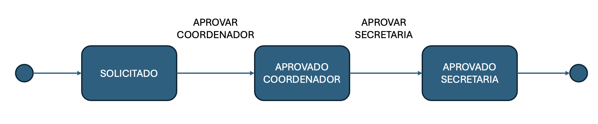

# ms-2026-02 - Microservices Development

## Instalação

- Para quem não tiver o [VS Code](https://code.visualstudio.com/download?_exp_download=fb315fc982)

- [Spring Boot para VS Code](https://code.visualstudio.com/docs/java/java-spring-boot)

## Injeção de Dependência

- Calculadora **monolítico**
```java
public class CalculadoraMonolitica {

    public void calcular(String[] args) {
        String operacao = args[0];
        Integer n1 = Integer.parseInt(args[1]);
        Integer n2 = Integer.parseInt(args[2]);

        System.out.println("\n\n------------ CALCULADORA MONOLITICA ------------");
        System.out.print("Resultado: ");

        if (operacao.equals("soma")) {
            System.out.println(n1 + n2);
        } else if (operacao.equals("subtracao")) {
            System.out.println(n1 - n2);
        } else if (operacao.equals("divisao")) {
            System.out.println(n1 / n2);
        } else if (operacao.equals("multiplicacao")) {
            System.out.println(n1 * n2);
        } else {
            System.out.println("Operacao invalida: " + operacao);
        }

        System.out.println();

    }

    public static void main(String[] args) {

        // Calculadora instanciada pelo usuário, dono do fluxo principal
        CalculadoraMonolitica c = new CalculadoraMonolitica();
        c.calcular(args);

    }
}
```
- Calculadora com **Spring**
- Criar uma interface para abstrair as operações
```java
public interface Operacao {

    String getNome();

    float executar(float v1, float v2);
}
```
- Implementar as operações como componentes (Soma, Multiplicação, etc...)
```java
import org.springframework.stereotype.Component;

@Component
public class Soma implements Operacao {

    @Override
    public String getNome() {
        return "soma";
    }

    @Override
    public float executar(float v1, float v2) {
        return v1 + v2;
    }

}
```
- Implementar a calculadora
```java
import java.util.List;
import org.springframework.stereotype.Component;

@Component
public class Calculadora {

    private final List<Operacao> operacoes;

    public Calculadora(List<Operacao> operacoes) {
        this.operacoes = operacoes;
    }

    public float calcular(String operacao, float v1, float v2) {

        System.out.println("Operacao: " + operacoes);

        for (Operacao op : operacoes) {
            if (op.getNome().equals(operacao))
                return op.executar(v1, v2);
        }

        return 0;
    }
}
```
- Finalmente, a aplicação principal
```java

import org.springframework.boot.CommandLineRunner;
import org.springframework.boot.SpringApplication;
import org.springframework.boot.autoconfigure.SpringBootApplication;

@SpringBootApplication
public class DemoApplication implements CommandLineRunner {

	private final Calculadora calculadora;

	public DemoApplication(Calculadora calculadora) {
		this.calculadora = calculadora;
	}

	public static void main(String[] args) {
		SpringApplication.run(DemoApplication.class, args);
	}

	@Override
	public void run(String... args) {

		String operacao = args[0];
		Integer a = Integer.parseInt(args[1]);
		Integer b = Integer.parseInt(args[2]);

		System.out.println(calculadora.calcular(operacao, a, b));

	}

}
```
- Implementar as demais operações (`subtracao`, `divisao` e `multiplicacao`)
## Criando um Endpoint para Calculadora
- Adicionar as dependências abaixo no `pom.xml`
    ```xml
    <dependency>
        <groupId>org.springframework.boot</groupId>
        <artifactId>spring-boot-starter-web</artifactId>
    </dependency>
    
    <dependency>
        <groupId>org.springframework.boot</groupId>
        <artifactId>spring-boot-devtools</artifactId>
        <scope>runtime</scope>
        <optional>true</optional>
    </dependency>
    ```
- Criar um *endpoint* para uma requisição *GET* (http://localhost:8080/calcular/soma?v1=10&v2=40)
```java
import org.springframework.web.bind.annotation.RequestMapping;
import org.springframework.web.bind.annotation.RestController;
import org.springframework.web.bind.annotation.GetMapping;
import org.springframework.web.bind.annotation.PathVariable;

@RestController
@RequestMapping("/calcular")
public class CalculadoraController {

    // Spring faz a injeção de dependência
    Calculadora calculadora;

    public CalculadoraController(Calculadora calculadora) {
        this.calculadora = calculadora;
    }

    @GetMapping("/{operacao}")
    public float calcular(@PathVariable String operacao, Float v1, Float v2) {
        return calculadora.calcular(operacao, v1, v2);
    }
}
```
- Exemplo de uma requisição **HTTP** com o *telnet*
```bash
GET /calcular/soma?v1=10&v2=20 HTTP/1.1
Host: localhost:8080
```
- Exemplo utilizando o *curl*
```bash
curl http://localhost:8080/calcular/soma?v1=10&v2=20
```
## Frontend para Calculadora
- Dentro da pasta `main/java/resources/static` criar os arquivos:
- HTML (`index.html`)
```html
<!DOCTYPE html>
<html lang="pt-BR">

<head>
    <meta charset="UTF-8">

    <meta name="viewport"
          content="width=device-width, initial-scale=1.0">

    <title>Calculadora</title>

    <link rel="stylesheet"
          href="calculadora.css">
</head>

<body>

    <div class="calculadora">

        <h1>Calculadora</h1>

        <div class="campo">
            <label for="v1">Valor 1</label>

            <input
                id="v1"
                type="number"
                step="any"
                placeholder="Digite o primeiro valor">
        </div>

        <div class="campo">
            <label for="operacao">Operação</label>

            <select id="operacao">
                <option value="soma">Soma (+)</option>
                <option value="subtracao">Subtração (-)</option>
                <option value="multiplicacao">Multiplicação (*)</option>
                <option value="divisao">Divisão (/)</option>
            </select>
        </div>

        <div class="campo">
            <label for="v2">Valor 2</label>

            <input
                id="v2"
                type="number"
                step="any"
                placeholder="Digite o segundo valor">
        </div>

        <button onclick="calcular()">
            Calcular
        </button>

        <div class="resultado">
            Resultado:
            <span id="resultado">?</span>
        </div>

    </div>

    <script src="calculadora.js"></script>

</body>

</html>
```
- CSS (`calculadora.css`)
```css
* {
    box-sizing: border-box;
}

body {
    margin: 0;
    min-height: 100vh;
    display: flex;
    justify-content: center;
    align-items: center;
    font-family: Arial, sans-serif;
}

.calculadora {
    width: 380px;
    padding: 32px;
    background-color: white;
    border-radius: 20px;
    box-shadow: 0 10px 30px rgba(0, 0, 0, 0.2);
}

h1 {
    margin-top: 0;
    margin-bottom: 30px;
    text-align: center;
    color: #333;
}

.campo {
    margin-bottom: 18px;
}

label {
    display: block;
    margin-bottom: 6px;
    font-weight: bold;
    color: #555;
}

input,
select {
    width: 100%;
    padding: 12px 14px;
    font-size: 16px;
    border: 1px solid #ccc;
    border-radius: 10px;
    outline: none;
    transition: border-color 0.2s,
                box-shadow 0.2s;
}

input:focus,
select:focus {
    border-color: #667eea;
    box-shadow: 0 0 0 3px rgba(102, 126, 234, 0.15);
}

button {
    width: 100%;
    padding: 13px;
    margin-top: 10px;
    border: none;
    border-radius: 10px;
    background-color: #667eea;
    color: white;
    font-size: 16px;
    font-weight: bold;
    cursor: pointer;
    transition: background-color 0.2s,
                transform 0.1s;
}

button:hover {
    background-color: #5568d9;
}

button:active {
    transform: scale(0.98);
}

.resultado {
    margin-top: 25px;
    padding: 15px;
    text-align: center;
    background-color: #f3f4ff;
    border-radius: 10px;
    color: #333;
}

#resultado {
    font-size: 24px;
    font-weight: bold;
    color: #667eea;
}
```
- Javascript (`calculadora.js`)
```javascript
async function calcular() {

    const v1 = document.getElementById("v1").value;
    const v2 = document.getElementById("v2").value;
    const operacao = document.getElementById("operacao").value;

    const url = `http://localhost:8080/calcular/${operacao}?v1=${v1}&v2=${v2}`;

    const response = await fetch(url);
    const resultado = await response.text();
    document.getElementById("resultado").textContent = resultado;
}
```
- Importante: incluir a propriedade `server.port=8081` no arquivo `application.properties`
- Incluir no `CalculadoraController` o controle de **CORS** `@CrossOrigin(origins = "http://localhost:8081")`

## Criando um Endpoint para Aluno
- Criar um *endpoint* para uma requisição *GET*
    ```java
    import org.springframework.web.bind.annotation.RestController;
    import org.slf4j.Logger;
    import org.slf4j.LoggerFactory;
    import org.springframework.web.bind.annotation.GetMapping;
    import org.springframework.web.bind.annotation.RequestMapping;
    
    @RestController
    @RequestMapping("/aluno")
    public class Aluno {
        // para geração de mensagens de log é aconselhado utilizar o Logger
        private static final Logger logger = LoggerFactory.getLogger(Aluno.class);
    
        @GetMapping("/obter")
        public String getAluno() {
            logger.debug("Retornando aluno Joao...");
            return "Joao";
        }
    
    }
    ```
- Utilizando `ResponseEntity`
    ```java
    @GetMapping("/obter")
    public ResponseEntity<String> getAluno() {
      return new ResponseEntity<String>("Joao", HttpStatus.OK);
    }
    ```
- [Códigos Status HTTP](https://developer.mozilla.org/en-US/docs/Web/HTTP/Status)
## Trabalhando com Propriedades
- Editar o arquivo `application.properties`
- Por exemplo, definir o nível de *log*

```javascript
logging.level.org.springframework.web=DEBUG
logging.level.nome.pacote=DEBUG
```
- Pode-se criar qualquer tipo de propriedade
- Para ler uma propriedade basta utilizar a injeção de dependência com `@Value`
```java
@Value("${mensagem}")
private String mensagem;
```
- Lê o valor da propriedade `mensagem` definida no arquivo `application.properties`
## Obtendo Parâmetros
- Na própria URL
```java
@GetMapping("/obter/{id}")
public String getAlunoPorNome(@PathVariable String id) {
    logger.debug("Retornando aluno com id = " + id);
    return "Encontrado aluno: " + id;
}
```
- Via parâmetros

```java
@GetMapping("/obter")
public String getAlunoPorNome(@RequestParam(name="id", required = false, defaultValue = "0") String id) {
    logger.debug("Retornando aluno com id = " + id);
    return "Encontrado aluno: " + id;
}
```

## Retornando JSON

- Criar uma classe para encapsular os atributos
```java
public class AlunoBean {

private String id;
private String nome;

@JsonIgnore
private String senha;

public AlunoBean(String id, String nome) {
    super();
    this.id = id;
    this.nome = nome;
}
// criar os gets / sets

}
```
- Para retornar *XML*
    ```xml
    <dependency>
    <groupId>com.fasterxml.jackson.dataformat</groupId>
    <artifactId>jackson-dataformat-xml</artifactId>
    </dependency>
    ```
- Alterar o parâmetro do *header* da requisição `Accept: application/xml`
## Processando POST
- Processando requisições do tipo *POST*
```java
@PostMapping("/cadastrar")
public ResponseEntity<Integer> cadastrar(@RequestBody AlunoBean aluno) {
    logger.debug("Cadastrando aluno: " + aluno.getNome());
    return new ResponseEntity<Integer>(Integer.parseInt("1"), HttpStatus.OK);
}
```
- Exemplo utilizando o *curl*
```bash
curl -X POST -H "Content-Type: application/json" -d '{"nome":"Joao","idade":20}' http://localhost:8080/alunos
```
- Uma opção para requisições *restful* dentro do *VS Code* é a *extension* **Thunder Client** ou instalar o [Postman](https://www.postman.com/downloads/)
- Exemplo de requisição *GET* com *javascript* para o *frontend* da aplicação
```javascript
async function buscarUsuario() {
    try {
        const response = await fetch("http://localhost:8080/users/joao");

        const data = await response.json();

        console.log(data);
    } catch (error) {
        console.error("Erro:", error);
    }
}
```
- Exemplo de *POST*
```javascript
async function criarUsuario() {

    const usuario = {
        username: "joao",
        senha: "123456",
        nomeCompleto: "João da Silva"
    };

    try {

        const response = await fetch("http://localhost:8080/users", {
            method: "POST",

            headers: {
                "Content-Type": "application/json"
            },

            body: JSON.stringify(usuario)
        });

        const data = await response.json();

        console.log(data);

    } catch (error) {
        console.error("Erro:", error);
    }
}
```
## Tratamento de Erros
- Criar uma classe para encapsular o tipo de exceção
```java
public class AlunoNaoLocalizadoException extends RuntimeException {
}
```
- Definir uma classe para lidar com as exceções
```java
@RestControllerAdvice
public class GlobalExceptionHandler {
    @ResponseStatus(
            value = HttpStatus.NOT_FOUND,
            reason = "Aluno não localizado!")
    @ExceptionHandler(AlunoNaoLocalizadoException.class)
    public void handleException(AlunoNaoLocalizadoException e) {

    }
}
```
- Lançar a exceção, quando aplicado
```java
throw new AlunoNaoLocalizadoException();
```
***
## Validação de Dados
- Utilizar o `spring-boot-starter-validation`
```xml
<dependency>
<groupId>org.springframework.boot</groupId>
<artifactId>spring-boot-starter-validation</artifactId>
</dependency>
```
- [Referência](https://docs.oracle.com/javaee/7/api/javax/validation/constraints/package-summary.html)
- Exemplo
```java
@PostMapping
public ResponseEntity<AlunoBean> criar(@Valid @RequestBody AlunoBean aluno) {
return new ResponseEntity<AlunoBean>(aluno, HttpStatus.OK);
}
```
- Na classe `AlunoBean` definir as restrições
```java
@Size(min = 10, message="Nome deve conter no minimo 10 caracteres")
private String nome;
```
- Definir o tratamento de erro no *Controller Advice* (`GlobalExceptionHandler`) caso o tratamento seja global
```java
@ResponseStatus(HttpStatus.BAD_REQUEST)
@ExceptionHandler(MethodArgumentNotValidException.class)
public Map<String, String> handleMethodArgumentNotValid(MethodArgumentNotValidException ex) {
    Map<String, String> errors = new HashMap<String, String>();
    ex.getBindingResult().getFieldErrors().forEach(error ->
    errors.put(error.getField(), error.getDefaultMessage()));
    return errors;
}
```
***
## Persistência
- Utilizar o `spring-boot-starter-data-jpa`
```xml
<dependency>
    <groupId>org.springframework.boot</groupId>
    <artifactId>spring-boot-starter-data-jpa</artifactId>
</dependency>

<dependency>
    <groupId>com.h2database</groupId>
    <artifactId>h2</artifactId>
    <scope>runtime</scope>
</dependency>

<dependency>
    <groupId>org.springframework.boot</groupId>
    <artifactId>spring-boot-h2console</artifactId>
</dependency>
```
- [Console H2](http://localhost:8080/h2-console)
- Configurar o **H2**
```javascript
spring.datasource.url=jdbc:h2:mem:testdb
spring.datasource.driverClassName=org.h2.Driver
spring.datasource.username=sa
spring.datasource.password=password
spring.jpa.database-platform=org.hibernate.dialect.H2Dialect
spring.h2.console.enabled=true
spring.jpa.defer-datasource-initialization=true
```
- Criar um arquivo `data.sql` dentro da pasta `resources`
```sql
DROP TABLE IF EXISTS tab_aluno;

CREATE TABLE tab_aluno (
    id_aluno INT AUTO_INCREMENT PRIMARY KEY,
    nome VARCHAR(30) NOT NULL,
    turma VARCHAR(10) NOT NULL,
    curso VARCHAR(50) DEFAULT NULL
);

INSERT INTO tab_aluno(nome, turma, curso) VALUES ('Joao Pereira', 'XPTO1', 'CDN');

INSERT INTO tab_aluno(nome, turma, curso) VALUES ('Maria Silva', 'XPTO2', 'CDN');
```
- Definir a *Entidade* para a persistência
```java
import jakarta.persistence.Column;
import jakarta.persistence.Entity;
import jakarta.persistence.GeneratedValue;
import jakarta.persistence.GenerationType;
import jakarta.persistence.Id;
import jakarta.persistence.Table;

@Entity
@Table(name="TAB_ALUNO")
public class AlunoEntity {
@Id
@Column(name = "ID_ALUNO")
@GeneratedValue(strategy=GenerationType.IDENTITY)
private Integer id;
private String nome;
private String turma;
private String curso; 
// getters e setters
```
- Criar o repositório (`extends CrudRepository`)
```java
import org.springframework.data.repository.CrudRepository;

public interface AlunoRepository extends CrudRepository<AlunoEntity, Integer>{
}
```
- Métodos disponíveis de `CrudRepository`
    - `save(entidade)` – persiste uma entidade (insert / update)
    - `deleteById(id)` – remove um registro por meio do id
    - `deleteAll()` – remove todos os registros
    - `findAll()` – retorna todos os registros
    - `findById(id)` – localiza um registro por meio do id
    - `count()` – retorna o número total de registros
    - `existis(id)` – verifica se um registro existe com base em seu id
- Utilizando no *controller*
```java
import org.springframework.web.bind.annotation.PostMapping;
import org.springframework.web.bind.annotation.RequestBody;
import org.springframework.web.bind.annotation.RequestMapping;
import org.springframework.web.bind.annotation.RestController;

@RestController
@RequestMapping(value = "aluno")
public class AlunoController {

    private AlunoRepository alunoRepo = null;

    public AlunoController(AlunoRepository alunoRepo) {
        this.alunoRepo = alunoRepo;
    }

    @PostMapping(value = "/cadastrar")
    public AlunoEntity cadastrar(@RequestBody AlunoEntity aluno) {
        return alunoRepo.save(aluno);
    }

}
```
- Retornando uma lista dos alunos cadastrados
```java
@GetMapping("/listar")
public ResponseEntity<Iterable<AlunoEntity>> listarTodos() {
    return new ResponseEntity<Iterable<AlunoEntity>>(alunoRepo.findAll(), HttpStatus.OK);
}
```
- **Exercício:** Complementar o *CRUD* para alunos com as opções de atualização e exclusão de um aluno pelo seu id
### Consultas Derivadas
- [Referência](https://docs.spring.io/spring-data/jpa/docs/current/reference/html/#jpa.query-methods)
- É possível criar consultas simples porém de forma muito eficiente utilizando-se consultas derivadas, isto é, que seguem um determinado padrão de nomenclatura envolvendo nomes de atributos da entidade
- Basta declarar a assinatura do método desejado na interface `CrudRepository`
- Por exemplo, `findByNome (String nome)` efetua uma busca utilizando como chave o atributo nome
- Outros exemplos:
    - `findByNomeIsNot(String nome)` – nomes diferentes de...
    - `findByTurmaIsNull()` – alunos onde o atributo turma seja nulo
    - `findByNomeContaining(String prefixo)` – alunos cujo nome contenha o prefixo informado
    - `findByNomeLike(String expressao)` – efetua um like no nome, por exemplo, %Joao%
### Consultas Personalizadas
- Além das consultas derivadas também é possível criar consultas personalizadas informando o código *SQL* diretamente
```java
@Query("select a from AlunoEntity a where a.turma = ?1")
public List<AlunoEntity> alunosPorTurma(String turma);
```
- Exemplos:
```java
public interface AlunoRepository extends CrudRepository<AlunoBean, Integer> {

    // sempre inicia com findBy...
    // incluir nome do atributo
    Iterable<AlunoEntity> findByCurso(String curso);

    // SELECT * FROM TAB_CURSO WHERE CURSO = ? AND TURMA = ?
    Iterable<AlunoEntity> findByCursoAndTurma(String curso, String turma);

    // SELECT * FROM TAB_ALUNO WHERE NOME LIKE ?
    Iterable<AlunoEntity> findByNomeLike(String nome);

}
```
### Exercício
- Criar um serviço para a criação de usuários para acesso a um sistema:
    - Permitir o cadastro de um novo usuário contendo `username`, `senha` e `nome completo`;
    - Possibilitar que o usuário troque a senha informando o `username`, `senha` antiga e a nova;
    - Verificar o `username` e `senha` e retornar `true` caso `username` e `senha` sejam válidos ou `false` caso contrário;
    - Bloquear o usuário caso ele erre o login em mais do que 3 tentativas;
    - Desbloquear um usuário que esteja bloqueado;
    - Listar os usuários cadastrados;
    - Listar o histório de *login* de um usuário contendo a data do login e se foi bem sucedido ou não;
    - Elaborar um *frontend* utilizando como modelo o conteúdo do git [login-web](https://github.com/esensato/ms-2026-02/tree/main/aula/login-web)
### Data Rest
- Permite criar endpoints diretamente do repositório sem a necessidade de um *controller*
```xml
<dependency>
<groupId>org.springframework.boot</groupId>
<artifactId>spring-boot-starter-data-rest</artifactId>
</dependency>
```
- Criar apenas a interface `CrudRepository`
- Adicionar uma configuração `spring.data.rest.basePath=/api`
- Para testar: `http://localhost:8080/api`
- [Referência](https://docs.spring.io/spring-data/rest/docs/current-SNAPSHOT/reference/html/#reference)
- Por exemplo, para um serviço de gerenciamento de disciplinas com o *SQL* abaixo
```sql
DROP TABLE IF EXISTS tab_disciplina;

CREATE TABLE tab_disciplina (
    id_disciplina INT AUTO_INCREMENT PRIMARY KEY,
    nome VARCHAR(30) NOT NULL,
    creditos INTEGER);

INSERT INTO tab_disciplina(nome, creditos) VALUES ('Estrutura de Dados', 10);

INSERT INTO tab_disciplina(nome, creditos) VALUES ('Gestão de Projetos', 15);
```
- Definir a *Entidade* para a persistência
```java
import jakarta.persistence.Column;
import jakarta.persistence.Entity;
import jakarta.persistence.GeneratedValue;
import jakarta.persistence.GenerationType;
import jakarta.persistence.Id;
import jakarta.persistence.Table;

@Entity
@Table(name="TAB_DISCIPLINA")
public class DisciplinaEntity {
@Id
@Column(name = "ID_DISCIPLINA")
@GeneratedValue(strategy=GenerationType.IDENTITY)
private Integer id;
private String nome;
private Integer creditos;
// getters e setters
```
- Utilizar a anotação `@RestResource` para bloquear determinados métodos
- `@RepositoryRestResource` pode ser utilizado para definir o caminho para acessar o *endpoint*
```java
import org.springframework.data.repository.CrudRepository;
import org.springframework.data.rest.core.annotation.RepositoryRestResource;

@RepositoryRestResource(path = "disciplina")
public interface DisciplinaRepository extends CrudRepository<DisciplinaEntity, Integer> {

    @Override
    @RestResource(exported = false)
    void deleteById(String id);
}        
```
- Para incluir o atribudo `id` nas respostas das APIs mapeadas pelo *Data Rest*
```java
@Component
public class DataRestConfig implements RepositoryRestConfigurer {

    @Override
    public void configureRepositoryRestConfiguration(RepositoryRestConfiguration config, CorsRegistry cors) {
        // Incluir as classes Bean que terão seus ids expostos
        config.exposeIdsFor(MatriculaBean.class, DisciplinaBean.class);
    }

}
```
- Para maiores configurações [Vide](https://docs.spring.io/spring-data/rest/docs/current/api/org/springframework/data/rest/core/config/RepositoryRestConfiguration.html)
***
## Aplicação Console
- Para executar uma aplicação Spring Boot no console
```java
@Component
public class ConsoleSpring implements CommandLineRunner {

    @Override
    public void run(String... args) throws Exception {

    }

}
```
***
## Efetuando Requisições HTTP
- Alterar a dependência no `pom.xml` para não incluir o *tomcat* como servidor:
```xml
<dependency>
    <groupId>org.springframework.boot</groupId>
    <artifactId>spring-boot-starter-web</artifactId>
    <exclusions>
        <exclusion>
            <groupId>org.springframework.boot</groupId>
            <artifactId>spring-boot-starter-tomcat</artifactId>
        </exclusion>
    </exclusions>
</dependency>
```
- Utilizar o `RestClient`
```java
import org.springframework.boot.CommandLineRunner;
import org.springframework.boot.SpringApplication;
import org.springframework.boot.autoconfigure.SpringBootApplication;
import org.springframework.http.ResponseEntity;
import org.springframework.web.client.RestClient;

@SpringBootApplication
public class LocalAlunoClientApplication implements CommandLineRunner {

	public static void main(String[] args) {
		SpringApplication.run(LocalAlunoClientApplication.class, args);
	}

	@Override
	public void run(String... args) throws Exception {

		RestClient restClient = RestClient.create();

		ResponseEntity<String> result = restClient.get()
				.uri("http://localhost:8080/aluno/listar")
				.retrieve()
				.toEntity(String.class);
		System.out.println("Status: " + result.getStatusCode());
		System.out.println("Headers: " + result.getHeaders());
		System.out.println("Conteudo: " + result.getBody());

	}

}
```
- Efetuando um *POST* (sem retorno esperado no corpo da resposta)
```java
// incluir este import para o APPLICATION_JSON
import static org.springframework.http.MediaType.APPLICATION_JSON;

RestClient restClient = RestClient.create();

ResponseEntity<Void> result = restClient.post()
        .uri("http://localhost:8080/aluno/cadastrar")
        .contentType(APPLICATION_JSON)
        .body("{\"nome\":\"Aluno JSON\", \"curso\": \"CDN\", \"turma\":\"XPTO4\"}")
        .retrieve()
        .toBodilessEntity();
System.out.println("Status: " + result.getStatusCode());
```
## Trabalhando com JSON
- O **Spring Boot** já inclui o pacote **Jackson** para trabalhar com objetos *JSON*
- Principais classes e métodos:
    - `ObjectMapper`: efetua o mapeamento entre objetos / *strings* e *JSON*
    - `ObjectNode`: representa um nó (objeto) *JSON*
### Mapeando Atributos JSON para Objetos
- Utilizar o `ObjectMapper`:
```java
// incluir este import para o jackson
import tools.jackson.databind.ObjectMapper;
import tools.jackson.databind.node.ObjectNode;

ObjectMapper mapper = new ObjectMapper();
ObjectNode obj = mapper.createObjectNode();

obj.put("nome", "Aluno JSON");
obj.put("curso", "CDN");
obj.put("turma", "XPTO4");
```
- Caso já exista um objeto ele pode ser mais facilmente mapeado para o *JSON*
```java
Aluno aluno = objectMapper.readValue("{\"nome\":\"Aluno JSON\", \"curso\": \"CDN\", \"turma\":\"XPTO4\"}", Aluno.class);
```
***
### Open Feign
- Uma alternativa para realizar requisições HTTP
```xml
<dependency>
<groupId>org.springframework.cloud</groupId>
<artifactId>spring-cloud-starter-openfeign</artifactId>
<version>5.0.3</version>
</dependency>
```
- Habilitar o uso do OpenFeign (`@EnableFeignClients`) na classe `Application`
```java
@SpringBootApplication
@EnableFeignClients
public class AlunoApplication {

    public static void main(String[] args) {
        SpringApplication.run(AlunoApplication.class, args);
    }

}
```
- Implementar as requisições
```java
@FeignClient(name = "aluno", url = "${url}")
public interface AlunoClienteFeign {

    @GetMapping("/aluno/{id}")
    public ResponseEntity<AlunoEntity> obterAluno(@PathVariable Integer id);

}
```
- Testar o acesso
```java

@RestController
@RequestMapping("/matricula")
public class MatriculaController {

    private AlunoClienteFeign alunoFeign;

    public MatriculaController(AlunoClienteFeign alunoFeign) {
        this.alunoFeign = alunoFeign;
    }

    @GetMapping("/aluno/{id}")
    public ResponseEntity<AlunoEntity> obterAluno(@PathVariable Integer id) {
        return new ResponseEntity<AlunoEntity>(alunoFeign.obterAluno(id).getBody().titulo, HttpStatus.OK);
    }

}
```
# Exercício

    | Serviço      | Porta       |
    | -----------  | ----------- |
    | Aluno        | 8080        |
    | Disciplina   | 8081        |
    | Matrícula    | 8082        |
    | Faculdade    | 8083        |

- Implementar um serviço CRUD para disciplina com os seguintes requisitos (utilizar *Data Rest*):
    - Disciplina possui um id numérico sequencial, um nome e carga horária;
    - Criar um endpoint com método POST para criar uma nova disciplina (POST `http://localhost:8081/api/disciplina`);
    - Criar um endpoint GET para retornar os dados de uma disciplina por id (GET `http://localhost:8081/api/disciplina/{id}`)
    - Criar um endpoint GET para retornar uma lista contendo todas as disciplinas (GET `http://localhost:8081/api/disciplina`);
    - Criar um endpoint com um método PUT que permita alterar o nome e a carga horária de uma disciplina (PUT `http://localhost:8081/api/disciplina`);
    - Criar um endpoint com um método DELETE que permita excluir uma disciplina (DELETE `http://localhost:8081/api/disciplina/{id}`);
- Criar um serviço para controle de matrícula:
    - Matrícula possui id do aluno, id da disciplina e um status (ATIVO, CANCELADO)
    - Definir um endpoint para associar o id de um aluno ao id de uma disciplina (POST `http://localhost:8082/matricula/{idAluno}/{idDisciplina}`);
    - Definir um endpoint para cancelar a matrícula do aluno de uma disciplina alterando o status (DELETE `http://localhost:8082/matricula/{idAluno}/{idDisciplina}`);
- Criar um serviço orquestrador chamado faculdade para:
    - Retornar todas as disciplinas ativas de um determinado aluno (GET `http://localhost:8083/faculdade/disciplinas/{idAluno}`);
    - Retornar a carga horária total de um aluno (GET `http://localhost:8083/faculdade/carga/{idAluno}`);
    - Remover uma disciplina (somente permitir excluir uma disciplina que não possua alunos associados) (DELETE `http://localhost:8083/faculdade/disciplinas/{idDisciplina}`);
***
## Documentação Endpoints
- Padrão [OpenAPI](https://spec.openapis.org/oas/latest.html)
- Exemplo [Strava API](https://developers.strava.com/swagger/swagger.json)
- Utilizar o [Swagger](https://swagger.io/) para visualizar a documentação no padrão *OpenAPI*
- Adicionar a dependência:
```xml
<dependency>
    <groupId>org.springdoc</groupId>
    <artifactId>springdoc-openapi-starter-webmvc-ui</artifactId>
    <version>3.1.1</version>
</dependency>
```
- Visualizando os *endpoints*:
    - Formato JSON: http://localhost:8080/v3/api-docs
    - Formato YAML: http://localhost:8080/v3/api-docs.yaml
    - Interface HTML (Swagger): http://localhost:8080/swagger-ui/index.html
- Anotações para documentação:
    - End points:
    ```java
    @OpenAPIDefinition(info=@Info(title="Controle de Alunos"))
    ```
    - Operações: 
    ```java
    @Operation(summary = "Lista alunos", description = "Obtem a lista de todos os alunos", tags = { "alunos" })
    @Parameters(value={@Parameter(name = "id")})
    ```
    - Respostas:
    ```java
    @ApiResponses(value = {
    @ApiResponse(responseCode = "200", description = "Encontrou o aluno", content = { @Content(mediaType = "application/json",
    schema = @Schema(implementation = AlunoEntity.class)) }), @ApiResponse(responseCode = "400", description = "Id do aluno inválido",
    content = @Content),
    @ApiResponse(responseCode = "404", description = "Aluno não localizado",
    content = @Content) })
    ```
- Documentando as entidades
```java
@Schema(name="Aluno", description = "Representa um aluno")
public class AlunoEntity {
@Schema(name = "matricula", description = "Número de matrícula", required = true, example = "M12345")
private String matricula;
}
```
## Geração Clientes
- Em nodejs utilizar o pacote [openapi-client-axios](https://www.npmjs.com/package/openapi-client-axios)
- Criar um projeto *nodejs*
```bash
mkdir cliente-node
cd cliente-node
npm init -y
```
- Importar o `openape-client-axios` e `openapicmd`
```bash
npm i --save openapi-client-axios openapicmd
```
- Gerar o cliente
```bash
npx openapicmd typegen http://localhost:8080/v3/api-docs > openapi.d.ts
```
- Efetuar as chamadas aos *endpoints*
```javascript
const OpenAPIClientAxios = require("openapi-client-axios").default;

const api = new OpenAPIClientAxios({
    definition: "http://localhost:8080/v3/api-docs",
});
api.init()
    .then((client) =>
        client.cadastrar({}, { nome: "Teste Node", curso: "CDN", turma: "XPTO" })
    )
    .then((res) => console.log("Resultado:", res.data));
```
***
## Actuator
- Permite verificar a "saúde" (health) de um serviço, por exemplo, se ele está em execução, sua disponibilidade, configuração, etc...
- Incluir a seguinte dependência ao projeto:
```xml
<dependency>
<groupId>org.springframework.boot</groupId>
<artifactId>spring-boot-starter-actuator</artifactId>
</dependency>
```
- A porta do actuator pode ser alterada por meio da propriedade `management.server.port` (por exemplo, `8081`)
- Acessar a URL `http://localhost:8081/actuator` ou `http://localhost:8081/actuator/health`
- Para incluir maiores informações sobre as informações da disponibilidade dos serviços (*health*) basta ativar a configuração `management.endpoint.health.show-details=always`
- Outras informações podem ser adicionadas com a propriedade `management.endpoints.web.exposure.include=health,info`
- Por meio do actuator é também possível terminar um serviço (propriedade `management.endpoint.shutdown.enabled=true`)
- Outros tipos podem ser visualizados [aqui](https://docs.spring.io/spring-boot/reference/actuator/endpoints.html)
### Health Check Personalizado
- Um health check personalizado permite especificar quando um determinado serviço está acessível
```java
@Component
public class AlunoMonitor implements HealthIndicator {

    @Override
    public Health health() {
        return Health.down().build();
    }

}
```
- Por exemplo, pode-se verificar se o banco de dados está disponível
```java
@Component("Aluno")
public class AlunoMonitor implements HealthIndicator {

    private DataSource ds;

    public AlunoMonitor(DataSource ds) {
        this.ds = ds;
    }

    @Override
    public Health health() {
        try (Connection conn = ds.getConnection()) {
            Statement stmt = conn.createStatement();
            stmt.execute("select COUNT(*) from TAB_ALUNO");
        } catch (SQLException ex) {
            return Health.outOfService().withException(ex).build();
        }
        return Health.up().build();
    }

}
```
### Métricas
- Para habilitar mais *endpoints* alterar `management.endpoints.web.exposure.include=*`
- Como são muitas informações, é possível filtrar por categorias `health,info,metrics`
- As métricas podem ser obtidas no *endpoint* `/actuator/metrics`
- Exemplo de uma métrica personalizada:
```java
@Component
public class AlunoMetrica {
    AlunoMetrica(MeterRegistry registry) {
        registry.counter("alunos.criados", Tags.of("teste", "10"));
    }
}
```
- Melhorando as métricas para aluno
```java
@Component
public class AlunoMetrica {

    private final Counter alunosCriados;

    public AlunoMetrica(MeterRegistry registry) {
        alunosCriados = Counter.builder("alunos.criados")
                .description("Quantidade de alunos criados")
                .register(registry);
    }

    public void alunoCriado() {
        alunosCriados.increment();
    }
}
```
- Alterar a classe `AlunoController` para incrementar a métrica de alunos criados via injeção de dependência via método construtor
### Informações
- Algumas configurações podem ser habilitadas:
```java
management.info.java.enabled=true
info.app.name=@project.name@
info.app.description=@project.description@
info.app.version=@project.version@
info.app.encoding=@project.build.sourceEncoding@
info.app.java.version=@java.version@
```
- Os vários simbolos `@...@` vão corresponder às propriedades definidas no `pom.xml` (**maven**)
```xml
<project>
    <groupId>br.com.faculdade</groupId>
    <artifactId>aluno-service</artifactId>
    <version>1.0.0</version>
    <name>Aluno Service</name>
    <description>Microserviço responsável pelo gerenciamento de alunos</description>
</project>
```
***
### Prometheus
- Permite acompanhar as evolução das métricas na linha do tempo
- Instalar o [prometheus](https://prometheus.io/download/)
- Ou obter a imagem e iniciar um container do *Prometheus*
```bash
docker login docker.io
docker run -p 9095:9090 -v ./prometheus.yml:/etc/prometheus/prometheus.yml --name prometheus prom/prometheus
```
- Criar / alterar o arquivo *yaml* para configurar o *Prometheus* com o nome `prometheus.yml`
```yaml
global:
    scrape_interval:     15s
    evaluation_interval: 15s
scrape_configs:
    - job_name: 'faculdade'
      metrics_path: '/actuator/prometheus'
      scrape_interval: 5s
      static_configs:
        - targets: ["localhost:9099"]
```
- Com isso a interface de consulta do **prometheus** estará acessível em `http://localhost:9090/query`
- Incluir a dependência no *miscrosserviço* para gerar as métricas
```xml
<dependency>
<groupId>io.micrometer</groupId>
<artifactId>micrometer-registry-prometheus</artifactId>
</dependency>
```
- Habilitar o *endpoint* do *Prometheus* com a propriedade `management.endpoints.web.exposure.include=prometheus`
- Acessar o *endpoint* `http://localhost:9099/actuator/prometheus`
- Acessar na URL `http://localhost:9090`
- Eftuar as consultas:
    - `up`
    - `jvm_memory_used_bytes`
    - `system_cpu_usage`
    - `http_server_requests_seconds`
    - `http_server_requests_seconds_count`
    - `http_server_requests`
    - `sum(http_server_requests_seconds_count)`
    - `alunos_criados_total`
- Consultas mais complexas
```javascript
http_server_requests_seconds_count{
    method="GET",
    status="200",
    uri="/alunos"
}

sum by (uri) (http_server_requests_seconds_count)

sum(rate(http_server_requests_seconds_count[5m]))

sum(
  rate(http_server_requests_seconds_count{
    status=~"5.."
  }[5m])
)

sum(rate(http_server_requests_seconds_count{status=~"5.."}[5m]))
/
sum(rate(http_server_requests_seconds_count[5m]))

rate(http_server_requests_seconds_sum[5m])
/
rate(http_server_requests_seconds_count[5m])
```
### Grafana

- Efetuar o *download* [aqui](https://grafana.com/grafana/download?edition=oss)
- Iniciar o **grafana**
```bash
cd grafana/bin
grafana server
```
- Acessar a url `http://localhost:3000`
- Usuário e senha iniciais: `admin` / `admin`
- Criar a conexão com o **prometheus** na url `http://localhost:9090`
***
### Loki
- Logs devem ser criados com 
```java
private static final Logger log = LoggerFactory.getLogger(AlunoService.class);
...
log.info("Serviço iniciado...");
```
- Definir o caminho dos *logs* na aplicação `logging.file.name=logs/aluno-service.log`
- Efetuar o download [aqui](https://github.com/grafana/loki/releases/)
- Criar o arquivo `config.yaml`
```yml
auth_enabled: false

server:
  http_listen_port: 3100
  grpc_listen_port: 9096

common:
  instance_addr: 127.0.0.1
  path_prefix: ./loki-data

  storage:
    filesystem:
      chunks_directory: ./loki-data/chunks
      rules_directory: ./loki-data/rules

  replication_factor: 1

  ring:
    kvstore:
      store: inmemory

schema_config:
  configs:
    - from: 2024-01-01
      store: tsdb
      object_store: filesystem
      schema: v13
      index:
        prefix: index_
        period: 24h

ruler:
  alertmanager_url: http://localhost:9093
```
- Efetuar o download do Alloy [aqui](https://github.com/grafana/alloy/releases/tag/v1.20.1)
- Criar o arquivo de configuração (`config.alloy`)
```javascript
loki.source.file "aluno_service" {
  targets = [
    {
      __path__     = "/Users/esensato/projetos/aluno-service/logs/*.log",
      service     = "aluno-service",
      environment = "dev",
    },
  ]

  forward_to = [loki.write.local.receiver]

  file_match {
    enabled = true
  }
}

loki.write "local" {
  endpoint {
    url = "http://localhost:3100/loki/api/v1/push"
  }
}
```
- Iniciar o **alloy** com `alloy.exe run config.alloy`

### Spring Admin Server
- É uma interface web para administração das aplicações *Spring Boot*
- Criar um NOVO projeto *Sprint Boot* e adicionar as dependências:
```xml
<dependency>
    <groupId>org.springframework.boot</groupId>
    <artifactId>spring-boot-starter</artifactId>
</dependency>

<dependency>
    <groupId>org.springframework.boot</groupId>
    <artifactId>spring-boot-starter-web</artifactId>
</dependency>

<dependency>
    <groupId>de.codecentric</groupId>
    <artifactId>spring-boot-admin-starter-server</artifactId>
    <version>4.1.3</version>
</dependency>
```
- Especificamente para o **MacOS**
```xml
<dependency>
    <groupId>io.netty</groupId>
    <artifactId>netty-all</artifactId>
</dependency>
```
- Especificar a porta na qual o *Admin Server* irá executar: `server.port=9082`
- Na classe principal do projeto adicionar as seguintes anotações:
```java
@EnableAdminServer
@SpringBootApplication
public class AdminApplication {

    public static void main(String[] args) {
        SpringApplication.run(AdminApplication.class, args);
    }

}
```
- Acessar a interface administrativa: `http://localhost:9082`
- Registrar as aplicações que serão monitoradas, adicionando a dependência:
```xml
<dependency>
    <groupId>de.codecentric</groupId>
    <artifactId>spring-boot-admin-starter-client</artifactId>
    <version>4.1.3</version>
</dependency>
```
- Apontar para o *Admin Server* com as propriedades `spring.boot.admin.client.url=http://localhost:9082` e `management.endpoint.health.show-details=always`
***
## Segurança Básica
- Para garantir um nível de segurança mínimo para os *endpoints* é possível ativar um *starter*
```xml
<dependency>
<groupId>org.springframework.boot</groupId>
<artifactId>spring-boot-starter-security</artifactId>
</dependency>
```
- Observar após o início do serviço que é gerada uma senha automaticamnte para acesso:

`Using generated security password: 2cee0e0c-3e35-453d-ac8b-f3f040c849cf`

- Por padrão o usuário definido é *user*
- Ao tentar acessar qualquer *endpoint* sem fornecer as credenciais será gerado um erro HTTP 401 (Unauthorized)
- Para que seja autorizado o acesso deve-se definir no cabeçalho da requisição o tipo de Autorização *Basic* (`Authorization: Basic user:senha` - `user:senha` em *Base64*)
- Caso seja necessário fornecer um usuário e senha padrão basta editar o `application.properties` e definir as seguintes propriedades:
```javascript
spring.security.user.name = teste
spring.security.user.password = 123
```
- Para sobrescrever as propriedades padrão do **starter security** é necessário criar uma classe de configuração
```java
package local.microservicos.local.alunorestful;

import org.springframework.context.annotation.Bean;
import org.springframework.context.annotation.Configuration;
import org.springframework.security.config.annotation.web.builders.HttpSecurity;
import org.springframework.security.web.SecurityFilterChain;
import static org.springframework.security.config.Customizer.withDefaults;

@Configuration
public class SecurityConfig {

    @Bean
    SecurityFilterChain securityFilterChain(HttpSecurity http) throws Exception {

        http.httpBasic(withDefaults())
                .authorizeHttpRequests(auth -> auth.anyRequest().authenticated());
        return http.build();

    }
}
```
### Cross Site Request Forgery (CSRF)
- Cross-Site Request Forgery é um ataque em que um usuário autenticado pode ser induzido a realizar uma operação em uma aplicação sem perceber
- Para desabilitar o *CSRF* e *session*:
```java
import org.springframework.context.annotation.Bean;
import org.springframework.context.annotation.Configuration;
import org.springframework.security.config.annotation.web.builders.HttpSecurity;
import org.springframework.security.config.http.SessionCreationPolicy;
import org.springframework.security.web.SecurityFilterChain;

@Configuration
public class SecurityConfig {

    @Bean
    SecurityFilterChain securityFilterChain(HttpSecurity http) throws Exception {

        http.csrf(csrf -> csrf.disable())
                .sessionManagement(session -> session.sessionCreationPolicy(SessionCreationPolicy.STATELESS))

        return http.build();

    }

}
```
### CORS
- Criar uma aplicação web simples para efetuar uma requisição GET ao *endpoint* `http://localhost:8080/aluno/listar`
- Código **Nodejs**
```javascript
const express = require("express");
const path = require("path");

const app = express();

app.use(express.static(path.join(__dirname, "public")));

app.listen(3000, () => {
    console.log("Aplicação disponível em http://localhost:3000");
});
```
- Página `public/index.html`
```html
<!DOCTYPE html>
<html lang="pt-BR">

<head>
    <meta charset="UTF-8">
    <title>Teste CORS</title>
</head>

<body>

    <button onclick="consultar()">Consultar API</button>

    <h2 id="resultado"></h2>

    <script>
        async function consultar() {

            const resultado = document.getElementById("resultado");

            try {

                const response = await fetch("http://localhost:8080/aluno/listar");
                resultado.textContent = `HTTP ${response.status}`;

            } catch (error) {

                resultado.textContent = "Erro de CORS";
                console.error(error);
            }
        }
    </script>

</body>

</html>
```
- Inicialmente permitir todos os acessos `configuration.setAllowedOrigins(List.of("*"))`
```java
@Bean
CorsConfigurationSource corsConfigurationSource() {

    CorsConfiguration configuration = new CorsConfiguration();

    configuration.setAllowedOrigins(List.of("*"));
    configuration.setAllowedMethods(List.of("GET", "POST", "PUT", "DELETE", "OPTIONS"));
    configuration.setAllowedHeaders(List.of("*"));

    UrlBasedCorsConfigurationSource source = new UrlBasedCorsConfigurationSource();
    source.registerCorsConfiguration("/**",configuration);

    return source;
}
```
- Depois bloquear o acesso pelo site `configuration.setAllowedOrigins(List.of("http://localhost:8080"))`
## Personalizando a Segurança
- Configuração básica (*default*)
```java
import static org.springframework.security.config.Customizer.withDefaults;

@Configuration
public class SecurityConfig {

    @Bean
    SecurityFilterChain defauSecurityFilterChain(HttpSecurity http) throws Exception {

        http.csrf(csrf -> csrf.disable())
                .sessionManagement(session -> session.sessionCreationPolicy(SessionCreationPolicy.STATELESS))
                .formLogin(withDefaults())
                .httpBasic(withDefaults())
                .authorizeHttpRequests(auth -> auth.anyRequest().authenticated());

        return http.build();
    }

}
```
- As opções para o `authorizeHttpRequests` podem ser:
    - `authenticated()`
    - `denyAll()`
    - `permitAll()`
- Para *enspoints* específicos utilizar o `requestMatchers` ao invés de `anyRequest`
```java
http.authorizeHttpRequests(auth -> auth.requestMatchers("/aluno/info").permitAll())
.anyRequest().denyAll());
```
- Para desabilitar o formulário de *login* padrão (neste caso a tela de login será de responsabilidade do navegador)
```java
http.formLogin(config -> config.disable());
```
- Testar o acesso pelo *PostMan* passando usuário e senha como autenticação básica via *header*
- Para desabilitar a autenticação básica (nem a tela de login do navegaddor irá aparecer):
```java
http.httpBasic(config -> config.disable());
```
- Para acessar o serviço via *RestClient* incluir no *header* da requisição o valor para *Authorization*:
```java
String plainCreds = "teste:123";
byte[] plainCredsBytes = plainCreds.getBytes();
byte[] base64CredsBytes = Base64.getEncoder().encode(plainCredsBytes);
String base64Creds = new String(base64CredsBytes);
ResponseEntity<String> response = restClient.get()
                .uri("http://localhost:8080/aluno/listar")
                .header("Authorization", "Basic " + base64Creds)
                .retrieve()
                .toEntity(String.class);
```
- Para utilizar o **OpenFeign** é necessário criar uma classe para interceptar a requisição e inserir a autenticação
```java
import org.springframework.context.annotation.Bean;
import org.springframework.context.annotation.Configuration;

import feign.auth.BasicAuthRequestInterceptor;

@Configuration
public class FeignConfig {

    @Bean
    public BasicAuthRequestInterceptor basicAuthRequestInterceptor() {
        return new BasicAuthRequestInterceptor("user", "440c9d66-141b-464d-97c8-e7891d126781");
    }
}
```
- Então a chamada deve incluir um parâmetro `configuration`
```java
import org.springframework.cloud.openfeign.FeignClient;
import org.springframework.http.ResponseEntity;
import org.springframework.web.bind.annotation.GetMapping;

@FeignClient(name = "aluno", url = "${url}", configuration = FeignConfig.class)
public interface AlunoClient {

    @GetMapping("/aluno/listar")
    public ResponseEntity<String> listar();

}
```
- Melhorar a implementação deixando o usuário e senha no arquivo `application.properties`
```javascript
faculdade.api.url=http://localhost:8080
faculdade.api.username=user
faculdade.api.password=440c9d66-141b-464d-97c8-e7891d126781
```
- Criar uma classe de configuração
```java
@ConfigurationProperties(prefix = "faculdade.api")
public record FaculdadeApiProperties(
        String url,
        String username,
        String password) {
}
```
- Utilizar a classe de configuração
```java
@Configuration
@EnableConfigurationProperties(FaculdadeApiProperties.class)
public class FeignConfig {

    @Bean
    public BasicAuthRequestInterceptor basicAuthRequestInterceptor(FaculdadeApiProperties properties) {

        return new BasicAuthRequestInterceptor(
                properties.username(),
                properties.password()
        );
    }
}
```
#### Definindo Usuários em Memória
- Remover as propriedades padrão `spring.security.user.name` e `spring.security.user.password` do `application.properties`
- Na classe `SecurityConfig` adicionar o *bean* `userDetailsService`
```java
@Bean
public InMemoryUserDetailsManager userDetailsService(PasswordEncoder passwordEncoder) {

    UserDetails user = User.withUsername("user")
            .password("{noop}user")
            .roles("USER")
            .build();

    UserDetails admin = User.withUsername("admin")
            .password("{noop}admin")
            .roles("USER", "ADMIN")
            .build();

    return new InMemoryUserDetailsManager(user, admin);
}
```
- O valor `{noop}` para as senhas indica que elas não serão criptografadas
- Para criptografar as senhas implementar um outro *bean* `passwordEncoder`
```java
@Bean
public PasswordEncoder passwordEncoder() {
    PasswordEncoder encoder = PasswordEncoderFactories.createDelegatingPasswordEncoder();
    return encoder;
}
```
- Trocar a opção `{noop}` por `{bcrypt}`e informar a senha no formato [BCrypt](https://bcrypt-generator.com/)
#### Definindo Usuários em Banco de Dados (JDBC)
- Incluir a dependência:
```xml
<dependency>
    <groupId>org.springframework.boot</groupId>
    <artifactId>spring-boot-starter-jdbc</artifactId>
</dependency>

<dependency>
    <groupId>com.h2database</groupId>
    <artifactId>h2</artifactId>
    <scope>runtime</scope>
</dependency>

<dependency>
    <groupId>org.springframework.boot</groupId>
    <artifactId>spring-boot-devtools</artifactId>
    <scope>runtime</scope>
    <optional>true</optional>
</dependency>
```
- Configurar o **H2** como banco de dados de usuários
```java
spring.datasource.url=jdbc:h2:mem:segurancadb
spring.datasource.driverClassName=org.h2.Driver
spring.datasource.username=sa
spring.datasource.password=password
spring.jpa.database-platform=org.hibernate.dialect.H2Dialect
spring.jpa.defer-datasource-initialization=true
spring.h2.console.enabled=true
spring.jpa.show-sql=true
```
- Esta implementação utiliza um *schema* fixo para armazenar os dados do usuário de acordo como a *DDL* abaixo no arquivo `data.sql`
```sql
create table users(username varchar(50) not null primary key,password varchar(500) not null, enabled boolean not null);
create table authorities (username varchar(50) not null,authority varchar_ignorecase(50) not null,constraint fk_authorities_users foreign key(username) references users(username));
create unique index ix_auth_username on authorities (username,authority);
```
- Definir o *bean* como `JdbcUserDetailsManager` passando como parâmetro o *datasource* configurado
```java
@Bean
public JdbcUserDetailsManager userDetailsService(DataSource datasource) {

    return new JdbcUserDetailsManager(datasource);
}
```
#### Definindo Usuários em Banco de Dados (JPA)
- Incluir a dependência para o *JPA*
```xml
<dependency>
    <groupId>org.springframework.boot</groupId>
    <artifactId>spring-boot-starter-data-jpa</artifactId>
</dependency>
```
- Criar a entidade para representar o usuário e mapear para o *schema* de banco de dados
```sql
create table usuario(username varchar(50) not null primary key,password varchar(500) not null, roles varchar(500));

insert into usuario(username, password, roles) values ('admin', '{noop}admin', 'ROLE_ADMIN');

insert into usuario(username, password, roles) values ('user', '{noop}user', 'ROLE_USER');

```
- Por padrão, toda *role* deve ser precedida pelo prefixo `ROLE_`
```java
@Entity
@Table(name = "Usuario")
public class UsuarioEntity {

    @Id
    private String username;

    private String password;

    private String roles;
}
```
- Criar o repositório com um método para retornar o usuário a partir de um atributo, por exempo, o nome (que no caso é o `id`)
```java
@Repository
public interface SegurancaRepositorio extends CrudRepository<UsuarioEntity, String> {
    
}
```
- Implementar o próprio `UserDetailsService`
```java
@Service
public class SegurancaService implements UserDetailsService {

    @Autowired
    private SegurancaRepositorio repo;

    @Override
    public UserDetails loadUserByUsername(String username) throws UsernameNotFoundException {

        if (repo.findById(username).isPresent()) {
            UsuarioEntity usuario = repo.findById(username).get();
            List<GrantedAuthority> auth = new ArrayList<GrantedAuthority>();
            for (String role : usuario.getRoles().split("\\;")) {
                auth.add(new SimpleGrantedAuthority(role));
            }
            return new User(usuario.getUsername(), usuario.getPassword(), auth);
        } else
            throw new UsernameNotFoundException(username);
    }
}
```
- Remover o `userDetailsService` da classe de configuração!
#### Authorities e Roles
- **Authorities**: permissões mais específicas, mais granulares
- **Roles**: agrupamentos de **Authorities**
- Erros de autorização são representados pelo código HTTP *403* ao invés de *401*
- Alterar o `defauSecurityFilterChain` para implementar o uso de *roles* (observar que o nome das *roles* não deve iniciar por `ROLE_`)
```java
@Bean
SecurityFilterChain defauSecurityFilterChain(HttpSecurity http) throws Exception {

    http.authorizeHttpRequests((requests) -> requests.requestMatchers("/seguranca/info").permitAll()
            .requestMatchers("/seguranca/admin").hasRole("ADMIN").requestMatchers("/seguranca/user")
            .hasAnyRole("ADMIN", "USER"));
    http.formLogin(withDefaults());
    http.httpBasic(withDefaults());

    return http.build();
}
```
- Para capturar eventos de falha de autorização
```java
@Component
public class AuthorizationEvent {

    @EventListener
    public void onFailure(AuthorizationDeniedEvent<UsuarioEntity> evento) {

        System.out.println(evento.getAuthentication().get().getName());

    }
}
```
#### Tokens JWT
- Importar as dependências para a geração do **token JWT**
```xml
    <dependency>
        <groupId>io.jsonwebtoken</groupId>
        <artifactId>jjwt-api</artifactId>
        <version>0.12.6</version>
    </dependency>

    <dependency>
        <groupId>io.jsonwebtoken</groupId>
        <artifactId>jjwt-impl</artifactId>
        <version>0.12.6</version>
        <scope>runtime</scope>
    </dependency>

    <dependency>
        <groupId>io.jsonwebtoken</groupId>
        <artifactId>jjwt-jackson</artifactId>
        <version>0.12.6</version>
        <scope>runtime</scope>
    </dependency>
```
- Criar uma classe utilitária para gerar e validar o *token*
```java
import io.jsonwebtoken.Claims;
import io.jsonwebtoken.Jwts;

import javax.crypto.SecretKey;
import java.time.Instant;
import java.time.temporal.ChronoUnit;
import java.util.Date;
import java.util.Map;

@Service
public class JwtUtil {

    private final SecretKey key;

    public JwtUtil() {
        this.key = Jwts.SIG.HS256.key().build();
    }

    public String gerarToken(
            String username,
            Map<String, Object> claimsExtras) {

        Instant agora = Instant.now();

        return Jwts.builder()
                .subject(username)
                .claims(claimsExtras)
                .issuedAt(Date.from(agora))
                .expiration(Date.from(
                        agora.plus(1, ChronoUnit.HOURS)))
                .signWith(key, Jwts.SIG.HS256)
                .compact();
    }

    public Claims obterClaims(String token) {
        return Jwts.parser()
                .verifyWith(key)
                .build()
                .parseSignedClaims(token)
                .getPayload();
    }

    public boolean validarToken(String token) {
        try {
            obterClaims(token);
            return true;
        } catch (io.jsonwebtoken.JwtException
                 | IllegalArgumentException e) {
            return false;
        }
    }
}
```
- Criar o *endpoint* para obtenção do *token*
```java
import org.springframework.security.core.Authentication;
import java.util.Map;

// Incluir a injeção de dependência
private JwtUtil jwtUtil = null;

public AlunoController(JwtUtil jwtUtil) {
    this.jwtUtil = jwtUtil;
}

@GetMapping("/token")
public ResponseEntity<String> gerarToken(Authentication authentication) {

    String token = jwtUtil.gerarToken(authentication.getName(),Map.of());
    return ResponseEntity.ok(token);

}
```
- Criar um filtro para validar o *token*
```java
import io.jsonwebtoken.Claims;
import io.jsonwebtoken.JwtException;
import java.io.IOException;
import java.util.Collections;

import jakarta.servlet.FilterChain;
import jakarta.servlet.ServletException;
import jakarta.servlet.http.HttpServletRequest;
import jakarta.servlet.http.HttpServletResponse;

import org.springframework.security.authentication.UsernamePasswordAuthenticationToken;
import org.springframework.security.core.context.SecurityContextHolder;
import org.springframework.stereotype.Component;
import org.springframework.web.filter.OncePerRequestFilter;

@Component
public class JwtAuthenticationFilter extends OncePerRequestFilter {

    private final JwtUtil jwtUtil;

    public JwtAuthenticationFilter(JwtUtil jwtUtil) {
        this.jwtUtil = jwtUtil;
    }

    @Override
    protected void doFilterInternal(
            HttpServletRequest request,
            HttpServletResponse response,
            FilterChain filterChain)
            throws ServletException, IOException {

        String header = request.getHeader("Authorization");

        if (header == null || !header.startsWith("Bearer ")) {
            filterChain.doFilter(request, response);
            return;
        }

        String token = header.substring(7);

        try {
            Claims claims = jwtUtil.obterClaims(token);
            String username = claims.getSubject();

            if (username == null || username.isBlank()) {
                response.sendError(
                        HttpServletResponse.SC_UNAUTHORIZED,
                        "Token sem subject válido");
                return;
            }

            var authentication = new UsernamePasswordAuthenticationToken(
                    username,
                    null,
                    Collections.emptyList());

            SecurityContextHolder.getContext()
                    .setAuthentication(authentication);

        } catch (JwtException | IllegalArgumentException e) {
            SecurityContextHolder.clearContext();

            response.sendError(
                    HttpServletResponse.SC_UNAUTHORIZED,
                    "Token inválido ou expirado");
            return;
        }

        filterChain.doFilter(request, response);
    }
}
```
- Alterar a classe de configuração de segurança `SecurityConfig` para incluir o filtro criado acima
```java
@Configuration
public class SecurityConfig {

    @Bean
    SecurityFilterChain securityFilterChain(HttpSecurity http, JwtAuthenticationFilter jwtFilter) throws Exception {

        http.httpBasic(withDefaults())

                .authorizeHttpRequests(auth -> auth.requestMatchers("/aluno/token").authenticated())
                .authorizeHttpRequests(auth -> auth.requestMatchers("/aluno/listar").authenticated())
                .authorizeHttpRequests(auth -> auth.requestMatchers("/aluno/listar/turma/*").permitAll())
                .addFilterBefore(
                        jwtFilter,
                        UsernamePasswordAuthenticationFilter.class);
        ;
        return http.build();

    }
}
```
## Autenticação e Autorização com OAuth2
- Instalar o [Keycloack](https://www.keycloak.org/downloads) como provedor de autenticação
- Iniciar o **Keycloack** na pasta `bin` com o comando `kc start-dev`
- Acessar o console do *Keycloack* e criar o usuário inicial
- Parâmetros:
    - Realm: faculdade
    - Client: faculdade-client
    - Client público, sem client_secret
    - Direct Access Grants habilitado
    - Usuário: aluno
    - Senha: 123456
- Seguir o [Guia de Configuração do Keyglock](https://www.keycloak.org/getting-started/getting-started-docker)
- Existe também a possibilidade de utilizar a ferramenta cliente de administração `kcadm`
```bash
cd keycloak-26.8.2/bin
./kcadm.sh config credentials --server http://localhost:8080 --realm master --user admin

./kcadm.sh create realms -s realm=faculdade -s enabled=true

./kcadm.sh create clients \
  -r faculdade \
  -s clientId=faculdade-client \
  -s enabled=true \
  -s protocol=openid-connect \
  -s publicClient=true \
  -s directAccessGrantsEnabled=true \
  -s standardFlowEnabled=false

./kcadm.sh create users \
  -r faculdade \
  -s username=aluno \
  -s enabled=true

./kcadm.sh update users \
  -r faculdade \
  -q username=aluno \
  -s firstName=Aluno \
  -s lastName=Teste \
  -s email=aluno@faculdade.local \
  -s emailVerified=true \
  -s enabled=true

./kcadm.sh set-password \
  -r faculdade \
  --username aluno \
  --new-password 123456

USER_ID=$(./kcadm.sh get users \
  -r faculdade \
  -q username=aluno \
  --fields id \
  --format csv --noquotes)

echo "$USER_ID"

./kcadm.sh update users/$USER_ID \
  -r faculdade \
  -s firstName=Aluno \
  -s lastName=Teste \
  -s email=aluno@faculdade.local \
  -s emailVerified=true \
  -s enabled=true

./kcadm.sh update users/$USER_ID \
  -r faculdade \
  -s 'requiredActions=[]'

curl -X POST \
  http://localhost:8080/realms/faculdade/protocol/openid-connect/token \
  -H "Content-Type: application/x-www-form-urlencoded" \
  -d "client_id=faculdade-client" \
  -d "username=aluno" \
  -d "password=123456" \
  -d "grant_type=password"
```
- Criar as *roles*
```bash
./kcadm.sh create roles \
  -r faculdade \
  -s name=USER

./kcadm.sh create roles \
  -r faculdade \
  -s name=ADMIN

USER_ID=$(bin/kcadm.sh get users \
  -r faculdade \
  -q username=aluno \
  --fields id \
  --format csv --noquotes)

./kcadm.sh add-roles \
  -r faculdade \
  --uid "$USER_ID" \
  --rolename USER

./kcadm.sh add-roles \
  -r faculdade \
  --uid "$USER_ID" \
  --rolename ADMIN
```

- O token obtido pode ser decodificado em (Jwt)[https://jwt.io/]
- Para as requisições aos endpoints o token deve ser passado no header como 'Authorization': 'Bearer' + access_token
### Configuração no Spring
- Incluir a dependência abaixo:
```xml
<dependency>
    <groupId>org.springframework.boot</groupId>
    <artifactId>spring-boot-starter-oauth2-resource-server</artifactId>
</dependency>

<dependency>
    <groupId>org.springframework.security</groupId>
    <artifactId>spring-security-oauth2-jose</artifactId>
</dependency>
```
- Requisitar o token

```java
@GetMapping("/login/{usuario}/{senha}")
public ResponseEntity<String> logintoken(@PathVariable String usuario, @PathVariable String senha) {

    RestTemplate restTemplate = new RestTemplate();

    HttpHeaders headers = new HttpHeaders();
    headers.setContentType(MediaType.APPLICATION_FORM_URLENCODED);

    MultiValueMap<String, String> requestBody = new LinkedMultiValueMap<String, String>();
    requestBody.add("username", usuario);
    requestBody.add("password", senha);
    requestBody.add("client_id", "seguranca");
    requestBody.add("grant_type", "password");

    ResponseEntity<String> response = restTemplate.postForEntity(
            "http://localhost:9090/realms/seguranca/protocol/openid-connect/token",
            new HttpEntity<>(requestBody, headers), String.class);

    JSONObject json = new JSONObject(response.getBody());
    System.out.println(json);
    return response;
}
```
- Incluir essas propriedades
```properties
# Security Configuration
spring.security.oauth2.resourceserver.jwt.issuer-uri=http://localhost:9090/realms/FaculdadeHealm
spring.security.oauth2.resourceserver.jwt.jwk-set-uri=${spring.security.oauth2.resourceserver.jwt.issuer-uri}/protocol/openid-connect/certs

# JWT Configuration
jwt.auth.converter.resource-id=faculdade
jwt.auth.converter.principal-attribute=admin

# Logging Configuration
logging.level.org.springframework.security=TRACE
```
- Criar um conversor para o Token para obter as ROLES:
```java
import java.util.Collection;
import java.util.List;
import java.util.Map;
import java.util.stream.Collectors;
import java.util.stream.Stream;

import org.springframework.core.convert.converter.Converter;
import org.springframework.security.authentication.AbstractAuthenticationToken;
import org.springframework.security.core.GrantedAuthority;
import org.springframework.security.core.authority.SimpleGrantedAuthority;
import org.springframework.security.oauth2.jwt.Jwt;
import org.springframework.security.oauth2.server.resource.authentication.JwtAuthenticationToken;
import org.springframework.security.oauth2.server.resource.authentication.JwtGrantedAuthoritiesConverter;
import org.springframework.stereotype.Component;

@Component
public class JwtConverter implements Converter<Jwt, AbstractAuthenticationToken> {

    private final JwtGrantedAuthoritiesConverter jwtGrantedAuthoritiesConverter = new JwtGrantedAuthoritiesConverter();

    public JwtConverter() {
        super();
    }

    @Override
    public AbstractAuthenticationToken convert(Jwt jwt) {
        Collection<GrantedAuthority> authorities = Stream.concat(
                jwtGrantedAuthoritiesConverter.convert(jwt).stream(),
                extractResourceRoles(jwt).stream()).collect(Collectors.toSet());
        return new JwtAuthenticationToken(jwt, authorities, getPrincipalClaimName(jwt));
    }

    private String getPrincipalClaimName(Jwt jwt) {

        return jwt.getClaim("preferred_username");
    }

    private Collection<? extends GrantedAuthority> extractResourceRoles(Jwt jwt) {
        Map<String, List<String>> resourceAccess = jwt.getClaim("realm_access");
        Collection<String> resourceRoles = resourceAccess.get("roles");
        return resourceRoles.stream()
                .map(role -> new SimpleGrantedAuthority(role))
                .collect(Collectors.toSet());
    }
}
```
- Atualizar o `SecurityConfig`
```java

@Autowired
JwtConverter jwtConverter;

@Bean
SecurityFilterChain defaultSecurityFilterChain(HttpSecurity http) throws Exception {

    http.authorizeHttpRequests(
            (requests) -> requests.requestMatchers("/seguranca/login").permitAll()
                    .requestMatchers("/seguranca/user").hasAnyRole("USER", "ADMIN")
                    .requestMatchers("/seguranca/admin").hasRole("ADMIN")
                    .requestMatchers("/seguranca/info").permitAll());

    http.sessionManagement(sess -> sess.sessionCreationPolicy(SessionCreationPolicy.STATELESS));

    http.oauth2ResourceServer(oauth2 -> oauth2.jwt(jwt -> jwt.jwtAuthenticationConverter(jwtConverter)));

    http.csrf(csrf -> csrf.disable());

    return http.build();

}
```
- Testando
```bash
curl -X POST \
  http://localhost:9090/seguranca/login \
  -H "Content-Type: application/json" \
  -d '{"username":"aluno","password":"123456"}'

TOKEN="COLE_AQUI_O_ACCESS_TOKEN"

curl http://localhost:9090/seguranca/info

curl http://localhost:9090/seguranca/user -H "Authorization: Bearer $TOKEN"

curl http://localhost:9090/seguranca/admin -H "Authorization: Bearer $TOKEN"

curl http://localhost:9090/seguranca/user
```
## Kafka
- Efetuar o download e instalação do [Apache Kafka](https://kafka.apache.org/downloads)
- Para *Windows* os comandos abaixo devem ser executados no diretório do kafka `bin\windows`
- Gerar o id do cluster com `kafka-storage.bat random-uuid`
- Criar os diretórios `kafka-storage.bat format --standalone -t [COLE AQUI O RESULTADO DO ITEM ANTERIOR] -c ..\config\server.properties`
- Iniciar o *Kafka*: `kafka-server-start.bat ..\config\server.properties`
- Cria um novo tópico

`kafka-topics.bat --create --topic MeuTopico --bootstrap-server localhost:9092`

- Listar tópicos criados

`kafka-topics.bat --list --bootstrap-server localhost:9092`

- Inserir itens no tópico

`kafka-console-producer.bat --topic MeuTopico --bootstrap-server localhost:9092`

- Consumir itens do tópico

`kafka-console-consumer.bat --topic MeuTopico --from-beginning --bootstrap-server localhost:9092`

## Kafka e SpringBoot
- Adicionar a dependência:
```xml
<dependency>
    <groupId>org.springframework.boot</groupId>
    <artifactId>spring-boot-starter-web</artifactId>
</dependency>

<dependency>
<groupId>org.springframework.kafka</groupId>
<artifactId>spring-kafka</artifactId>
</dependency>

```
- Definindo as propriedades
```
# Kafka Broker
spring.kafka.bootstrap-servers=localhost:9092

# Producer Configuration
spring.kafka.producer.key-serializer=org.apache.kafka.common.serialization.StringSerializer
spring.kafka.producer.value-serializer=org.apache.kafka.common.serialization.StringSerializer

# Consumer Configuration
spring.kafka.consumer.group-id=group_id
spring.kafka.consumer.auto-offset-reset=earliest
spring.kafka.consumer.key-deserializer=org.apache.kafka.common.serialization.StringDeserializer
spring.kafka.consumer.value-deserializer=org.apache.kafka.common.serialization.StringDeserializer

# Application Topics
topic.name.producer=topico.comando.teste
topic.name.consumer=topico.comando.teste
```
- Criando um tópico pelo próprio *Spring*
```java
import org.apache.kafka.clients.admin.NewTopic;
import org.springframework.context.annotation.Bean;
import org.springframework.context.annotation.Configuration;
import org.springframework.kafka.config.TopicBuilder;

@Configuration
public class KafkaConfig {

    @Bean
    public NewTopic topic() {
        return TopicBuilder.name("topico.comando.teste")
                .partitions(1)
                .replicas(1)
                .build();
    }
}
```
- Implementando o producer
```java
@Service
public class BolsaKafkaProducer {

    @Value("${topic.name.producer}")
    private String topicName;

    private static final Logger log = LoggerFactory.getLogger(BolsaKafkaProducer.class);

    private final KafkaTemplate<String, String> kafkaTemplate;

    public BolsaKafkaProducer(KafkaTemplate<String, String> kafkaTemplate) {
        this.kafkaTemplate = kafkaTemplate;
    }

    public void send(String message) {

        kafkaTemplate.send(topicName, message)
            .whenComplete((result, exception) -> {

                if (exception != null) {
                    log.error("Erro ao enviar mensagem", exception);
                } else {
                    log.info("Mensagem enviada: {}", message);
                    log.info("Tópico: {} | Partição: {}",
                            result.getRecordMetadata().topic(),
                            result.getRecordMetadata().partition());
                }
            });
    }
}

```
- Implementando o consumer
```java
@Service
public class BolsaKafkaConsumer {

    private static final Logger log = LoggerFactory.getLogger(BolsaKafkaConsumer.class);

    @KafkaListener(topics = "${topic.name.consumer}")
    public void consume(ConsumerRecord<String, String> payload) {

        log.info("Tópico: {}", payload.topic());
        log.info("Chave: {}", payload.key());
        log.info("Headers: {}", payload.headers());
        log.info("Partição: {}", payload.partition());
        log.info("Valor: {}", payload.value());
    }
}
```
- Endpoint do producer
```java
@RestController
@RequestMapping("/bolsa")
public class BolsaKafkaController {

    private final BolsaKafkaProducer producer;

    public BolsaKafkaController(BolsaKafkaProducer producer) {
        this.producer = producer;
    }

    @PostMapping("/producer")
    public ResponseEntity<String> producer(@RequestBody String mensagem) {

        producer.send(mensagem);
        return ResponseEntity.accepted().body("Mensagem encaminhada para publicação no Kafka!");
    }
}
```
- Para trabalhar com objetos java, criar, por exemplo uma classe
```java
public class OrdemBolsa {
    public String codigo;
    public String operacao;
    public Integer quantidade;
    public Double valor
}
```

- Serialização de Objetos
```
# Producer JSON
spring.kafka.producer.key-serializer=org.apache.kafka.common.serialization.StringSerializer
spring.kafka.producer.value-serializer=org.springframework.kafka.support.serializer.JsonSerializer

# Consumer JSON
spring.kafka.consumer.key-deserializer=org.apache.kafka.common.serialization.StringDeserializer
spring.kafka.consumer.value-deserializer=org.springframework.kafka.support.serializer.JsonDeserializer

spring.kafka.consumer.properties[spring.json.trusted.packages]=aula.microservicos.kafka.model
spring.kafka.consumer.properties[spring.json.value.default.type]=aula.microservicos.kafka.model.OrdemBolsa

```
- Atualizar o produtor
```java
@Service
public class BolsaKafkaProducer {

    private final KafkaTemplate<String, OrdemBolsa> kafkaTemplate;

    @Value("${topic.name.producer}")
    private String topicName;

    public BolsaKafkaProducer(
            KafkaTemplate<String, OrdemBolsa> kafkaTemplate) {
        this.kafkaTemplate = kafkaTemplate;
    }

    public void send(OrdemBolsa ordem) {

        kafkaTemplate.send(topicName, ordem)
            .whenComplete((result, exception) -> {

                if (exception != null) {
                    log.error("Erro ao enviar ordem", exception);
                } else {
                    log.info("Ordem enviada: {}", ordem);
                }
            });
    }
}
```
- Atualizar o consumidor
```java
@Service
public class BolsaKafkaConsumer {

    private static final Logger log = LoggerFactory.getLogger(BolsaKafkaConsumer.class);

    @KafkaListener(topics = "${topic.name.consumer}")
    public void consume(OrdemBolsa ordem) {

        log.info("Código: {}", ordem.codigo());
        log.info("Operação: {}", ordem.operacao());
        log.info("Quantidade: {}", ordem.quantidade());
        log.info("Valor: {}", ordem.valor());
    }
}
```
## Versionamento de API
- Via URL
```bash
GET /v1/aluno/10520
GET /v2/aluno/10520
```
- Header versioning
    ```java
    @GetMapping(value="/aluno", headers = "X-API-VERSION=1")
    public ResponseEntity<AlunoBeanV1> getAlunoV1Header() { 
    return new ResponseEntity<AlunoBeanV1>(new AlunoBeanV1(1, "Joao", "1000"), HttpStatus.OK); 
    }
    @GetMapping(value="/aluno", headers = "X-API-VERSION=2")
    public ResponseEntity<AlunoBeanV2> getAlunoV2Header() { 
    return new ResponseEntity<AlunoBeanV2>(new AlunoBeanV2(1, "Joao", "1000", 100), HttpStatus.OK); 
    }
    ```
    - Inserir um parâmetro no `header` da (`X-API-VERSION=1`) requisição com o valor da versão desejada
- Media-Type
    ```java
    @GetMapping(value="/aluno", produces="application/sistema.academico-v1+json")
    public ResponseEntity<AlunoBeanV1> getAlunoV1Produces() { 
    return new ResponseEntity<AlunoBeanV1>(new AlunoBeanV1(1, "Joao", "1000"), HttpStatus.OK); 
    }
    @GetMapping(value="/aluno", produces="application/sistema.academico-v2+json")
    public ResponseEntity<AlunoBeanV2> getAlunoV2Produces() { 
    return new ResponseEntity<AlunoBeanV2>(new AlunoBeanV2(1, "Joao", "1000", 100), HttpStatus.OK); 
    }
    ```
    - Inserir um parâmetro no `header` da (`Accept`) requisição com o valor da versão desejada (`application/sistema.academico-v1+json` ou `application/sistema.academico-v2+json`)


# Gestão Centralizada de Configurações com Spring Cloud Config

## 1. Introdução

Em uma arquitetura de microserviços, normalmente temos diversas aplicações executando de maneira independente.

Cada aplicação possui suas próprias configurações, como:

- Endereço de bancos de dados.
- Portas de comunicação.
- Endereços de outros microserviços.
- Configurações de mensageria.
- Parâmetros específicos de cada ambiente.
- Credenciais e informações de conexão.

Um problema comum é a necessidade de manter essas configurações em diversos arquivos e aplicações.

Uma possibilidade para resolver esse problema é utilizar o **Spring Cloud Config Server**.

O Spring Cloud Config permite centralizar as configurações das aplicações em um repositório externo, disponibilizando essas informações por meio de uma API HTTP.

## 2. Arquitetura proposta

Vamos considerar uma arquitetura composta por três aplicações:

- `config-server`: responsável por centralizar e disponibilizar as configurações.
- `carro`: microserviço responsável pelo gerenciamento de veículos.
- `motorista`: microserviço responsável pelo gerenciamento de motoristas.

As configurações serão armazenadas em um repositório Git local.

## 3. Criando o repositório de configurações

No Linux:

```bash
mkdir -p ~/config-repo
cd ~/config-repo
git init
```

Crie os seguintes arquivos:

```text
config-repo/
    application.properties
    carro.properties
    carro-dev.properties
    carro-prd.properties
    motorista.properties
    motorista-dev.properties
    motorista-prd.properties
```

### 3.1. Configurações compartilhadas

Arquivo `application.properties`:

```properties
empresa.nome=Faculdade
sistema.versao=1.0
```

Essas propriedades estarão disponíveis para todas as aplicações.

### 3.2. Configurações do microserviço carro

Arquivo `carro.properties`:

```properties
spring.application.name=carro
carro.fabricante=Volkswagen
carro.limite.consulta=100
```

Arquivo `carro-dev.properties`:

```properties
server.port=8081
carro.ambiente=desenvolvimento
carro.database.url=jdbc:mysql://localhost:3306/carro_dev
```

Arquivo `carro-prd.properties`:

```properties
server.port=8081
carro.ambiente=producao
carro.database.url=jdbc:mysql://servidor-producao:3306/carro
```

### 3.3. Configurações do microserviço motorista

Arquivo `motorista.properties`:

```properties
spring.application.name=motorista
motorista.limite.consulta=50
```

Arquivo `motorista-dev.properties`:

```properties
server.port=8082
motorista.ambiente=desenvolvimento
```

Arquivo `motorista-prd.properties`:

```properties
server.port=8082
motorista.ambiente=producao
```

### 3.4. Registrando os arquivos no Git

```bash
git add .
git commit -m "Configuracoes iniciais dos microservicos"
```

## 4. Criando o Spring Cloud Config Server

Crie um projeto Spring Boot utilizando o Spring Initializr:

https://start.spring.io/

Adicione a dependência Config Server.

### 4.1. Dependência Maven

```xml
<dependency>
    <groupId>org.springframework.cloud</groupId>
    <artifactId>spring-cloud-config-server</artifactId>
</dependency>
```

Configure também o Spring Cloud BOM, utilizando uma versão compatível com a versão do Spring Boot:

```xml
<dependencyManagement>
    <dependencies>
        <dependency>
            <groupId>org.springframework.cloud</groupId>
            <artifactId>spring-cloud-dependencies</artifactId>
            <version>${spring-cloud.version}</version>
            <type>pom</type>
            <scope>import</scope>
        </dependency>
    </dependencies>
</dependencyManagement>
```

### 4.2. Habilitando o Config Server

```java
@SpringBootApplication
@EnableConfigServer
public class ConfigServerApplication {

    public static void main(String[] args) {
        SpringApplication.run(
            ConfigServerApplication.class, args);
    }
}
```

### 4.3. Configurando o repositório Git

Arquivo `application.properties`:

```properties
spring.application.name=config-server
server.port=8888

spring.cloud.config.server.git.uri=file://${user.home}/config-repo
spring.cloud.config.server.git.default-label=master
```

Verifique o nome da branch:

```bash
cd ~/config-repo
git branch --show-current
```

Se a branch for `main`, altere a propriedade `default-label` para `main`.

### 4.4. Iniciando o Config Server

Execute a aplicação Spring Boot.

O servidor estará disponível em:

```text
http://localhost:8888
```

## 5. Testando o Config Server

O Spring Cloud Config disponibiliza uma API HTTP para consultar as configurações.

O formato da URL é:

```text
/{application}/{profile}/{label}
```

Exemplos:

Consultar o microserviço carro no ambiente de desenvolvimento:

```bash
curl http://localhost:8888/carro/dev
```

Consultar o ambiente de produção:

```bash
curl http://localhost:8888/carro/prd
```

Consultar o microserviço motorista:

```bash
curl http://localhost:8888/motorista/dev
```

O servidor retornará um JSON contendo as propriedades encontradas.

## 6. Configurando o Config Client

Agora vamos configurar os microserviços para que possam consultar o Config Server.

Utilizaremos o microserviço `carro` como exemplo.

### 6.1. Dependência Maven

```xml
<dependency>
    <groupId>org.springframework.cloud</groupId>
    <artifactId>spring-cloud-starter-config</artifactId>
</dependency>
```

Utilize o mesmo Spring Cloud BOM e a mesma estratégia de gerenciamento de versões do Config Server.

### 6.2. Configurando o Config Client

Arquivo `application.properties`:

```properties
spring.application.name=carro

spring.config.import=configserver:http://localhost:8888

spring.profiles.active=dev
```

A propriedade `spring.application.name` identifica a aplicação.

A propriedade `spring.config.import` informa que a aplicação deverá consultar o Config Server durante sua inicialização.

A propriedade `spring.profiles.active` indica o ambiente utilizado.

Não é necessário definir adicionalmente `spring.cloud.config.profile`, pois os perfis ativos da aplicação são utilizados por padrão.

### 6.3. Iniciando o microserviço

Certifique-se de que o Config Server esteja em execução.

Depois, inicie o microserviço carro.

Durante a inicialização, o Spring Boot consultará o Config Server e carregará as configurações correspondentes.

A aplicação utilizará a porta `8081`, definida remotamente em `carro-dev.properties`.

## 7. Acessando as propriedades remotas

As propriedades obtidas do Config Server podem ser utilizadas normalmente na aplicação Spring Boot.

Crie um controller:

```java
@RestController
@RequestMapping("/carro")
public class CarroController {

    @Value("${empresa.nome}")
    private String empresa;

    @Value("${carro.fabricante}")
    private String fabricante;

    @Value("${carro.ambiente}")
    private String ambiente;

    @GetMapping("/info")
    public Map<String, String> info() {

        return Map.of(
            "empresa", empresa,
            "fabricante", fabricante,
            "ambiente", ambiente
        );
    }
}
```

Teste:

```bash
curl http://localhost:8081/carro/info
```

Resposta esperada:

```json
{
    "empresa": "Faculdade",
    "fabricante": "Volkswagen",
    "ambiente": "desenvolvimento"
}
```

As propriedades foram obtidas de diferentes arquivos:

- `application.properties`: empresa.
- `carro.properties`: fabricante.
- `carro-dev.properties`: ambiente.

## 8. Alterando o ambiente de execução

Para executar o microserviço carro em produção, altere o perfil ativo:

```properties
spring.profiles.active=prd
```

Ou inicie a aplicação com:

```bash
java -jar carro.jar --spring.profiles.active=prd
```

Nesse caso, o Spring Cloud Config consultará o arquivo:

```text
carro-prd.properties
```

O mesmo código-fonte poderá ser utilizado em diferentes ambientes, sem a necessidade de alterar diretamente os arquivos de configuração da aplicação.

## 9. Atualizando as configurações

Por padrão, o Config Client carrega as configurações durante a inicialização.

Uma alteração no repositório Git não atualiza automaticamente as propriedades de uma aplicação que já está em execução.

Uma possibilidade é reiniciar a aplicação.

Também podemos implementar atualização sob demanda utilizando Spring Boot Actuator e a anotação `@RefreshScope`.

### 9.1. Adicionando a dependência Actuator

```xml
<dependency>
    <groupId>org.springframework.boot</groupId>
    <artifactId>spring-boot-starter-actuator</artifactId>
</dependency>
```

### 9.2. Expondo o endpoint refresh

Arquivo `application.properties`:

```properties
management.endpoints.web.exposure.include=health,info,refresh
```

### 9.3. Utilizando RefreshScope

```java
@RestController
@RequestMapping("/carro")
@RefreshScope
public class CarroController {

    @Value("${carro.fabricante}")
    private String fabricante;

    @GetMapping("/fabricante")
    public String fabricante() {
        return fabricante;
    }
}
```

Após alterar e registrar as configurações no Git, execute:

```bash
git add .
git commit -m "Atualizacao das configuracoes"
```

Em seguida, solicite a atualização das configurações:

```bash
curl -X POST http://localhost:8081/actuator/refresh
```

O endpoint fará com que as configurações remotas sejam consultadas novamente e atualizará os componentes que utilizam `@RefreshScope`.

## Eureka
- É um servidor de nomes onde os microserviços podem ser registrados
- Com isso, não é necessário saber o host e porta onde se localizam na integração entre os microserviços
- Cada serviço deve se registrar no Eureka e deve consultá-lo para acessar os demais 

### Eureka Server
- Adicionar a dependência
    ```xml
    <dependency>
    <groupId>org.springframework.cloud</groupId>
    <artifactId>spring-cloud-starter-netflix-eureka-server</artifactId>
    </dependency>
    ```
- Definir as configurações
    ```properties
    spring.application.name=naming-server
    server.port=8761
    eureka.client.register-with-eureka=false
    eureka.client.fetch-registry=false
    ```
- Adicionar a anotação na classe principal (`@EnableEurekaServer`)
    ```java
    @SpringBootApplication
    @EnableEurekaServer
    public class Application {
    
        public static void main(String[] args) {
          SpringApplication.run(Application.class, args);
        }
    
    }
    ```
- Acessar em `http://localhost:8761`
### Eureka Cliente - Registro Nome
- Os serviços devem registrar-se junto ao servidor de nomes
- Para isso, incluir a dependência
    ```xml
    <dependency>
    <groupId>org.springframework.cloud</groupId>
    <artifactId>spring-cloud-starter-netflix-eureka-client</artifactId>
    </dependency>
    ```
- Incluir nas propriedades
    ```properties
    server.port=8020
    spring.application.name=nome_registro
    ```
### Eureka Cliente - Acesso ao Serviço
- Com os clientes registrados no servidor Eureka é possível acessá-los por meio dos nomes definidos em `spring.application.name`
- Incluir as configurações
    ```properties
    spring.application.name=nome_aplicacao
    eureka.client.serviceUrl.defaultZone=http://localhost:8761/eureka
    eureka.instance.hostname=localhost
    ```
- Utilizar o *OpenFeign* para facilicar o acesso aos serviços
    ```xml
    <dependency>
    <groupId>org.springframework.cloud</groupId>
    <artifactId>spring-cloud-starter-openfeign</artifactId>
    </dependency>
    ```
- Habilitar o uso do *OpenFeign*
    ```java
    @SpringBootApplication
    @EnableFeignClients
    public class Application {
    
        public static void main(String[] args) {
            SpringApplication.run(Application.class, args);
        }
    
    }
    ```
- Criar os *proxyes* para realizar as chamadas aos *endpoints*
    ```java
    @FeignClient(name = "validador-service", url = "localhost:8020")
    public interface ValidadorProxy {
        @GetMapping("/validar/{valor}")
        public ResponseEntity<Boolean> validar(@PathVariable String valor);
    }
    ```

- Injetar os *proxyes*
    ```java
    @Autowired
    private ValidadorProxy validador;
    @Autowired
    private CriptografiaProxy criptografia;
    ```
## Efetuando o Deploy
- Executar em um terminal os comandos:
    ```powershell
    ./mvn clean
    ./mvnw package -f "/Users/esensato/Documents/espm/repo/ms-2024-01/aula/kafka-producer/pom.xml"
    ```
- Para executar:
    ```powershell
    cd target kafka-producer-0.0.1-SNAPSHOT.jar 
    java -jar  
    ```
- Criar um `Dockerfile` com o conteúdo:
```dockerfile
    FROM openjdk:17
    RUN mkdir /app
    COPY kafka-producer-0.0.1-SNAPSHOT.jar /app
    WORKDIR /app
    RUN cd /app
    CMD ["java", "-jar", "kafka-producer-0.0.1-SNAPSHOT.jar"]
```
- Efetuar o *build* da imagem
```
    docker build -t kafka-producer .
```
- Executando o *container*
```
    docker run -d -p 8080:8080 --name producer kafka-producer
```
***
### Spring State Machine
- Aluno pode solicitar o cancelamento de uma matrícula em determinada disciplina
- Para isso, existe um *worflow* conforme abaixo

- Importar as dependências
```xml
<dependency>
    <groupId>org.springframework.statemachine</groupId>
    <artifactId>spring-statemachine-starter</artifactId>
    <version>3.2.1</version>
</dependency>
```
- Criar os estados e eventos
    ```java
    public enum CancelamentoMatriculaEstado {
        SOLICITADO, APROVADO_COORDENADOR, APROVADO_SECRETARIA
    }
    ```
    ```java
    public enum CancelamentoMatriculaEvento {
        APROVAR_COORDENADOR, APROVAR_SECRETARIA
    }
    ```
- A configuração da máquina de estados deve ser feita em uma classe anotada com `@Configuration` e `@EnableStateMachine`
    ```java
    @Configuration
    @EnableStateMachineFactory
    public class CancelamentoWorkflowConfig extends StateMachineConfigurerAdapter<CancelamentoMatriculaEstado, CancelamentoMatriculaEvento> {

        private static final Logger logger = LoggerFactory.getLogger(CancelamentoWorkflowConfig.class);
        
    }
    ```
- Configurar os estados
    ```java
    @Override
    public void configure(StateMachineStateConfigurer<CancelamentoMatriculaEstado, CancelamentoMatriculaEvento> states)
            throws Exception {

        states.withStates()
                .initial(CancelamentoMatriculaEstado.SOLICITADO, initialAction())
                .end(CancelamentoMatriculaEstado.APROVADO_SECRETARIA)
                .state(CancelamentoMatriculaEstado.APROVADO_COORDENADOR);

    }

    @Bean
    public Action<CancelamentoMatriculaEstado, CancelamentoMatriculaEvento> initialAction() {
        return new Action<CancelamentoMatriculaEstado, CancelamentoMatriculaEvento>() {

            @Override
            public void execute(StateContext<CancelamentoMatriculaEstado, CancelamentoMatriculaEvento> context) {
                logger.info("Iniciado o WF Cancelamento de Matricula");
            }
        };
    }
    ```
- Configurar as transições entre os estados
    ```java    
    @Override
    public void configure(
            StateMachineTransitionConfigurer<CancelamentoMatriculaEstado, CancelamentoMatriculaEvento> transitions)
            throws Exception {

        transitions.withExternal()
                .source(CancelamentoMatriculaEstado.SOLICITADO).target(CancelamentoMatriculaEstado.APROVADO_COORDENADOR)
                .event(CancelamentoMatriculaEvento.APROVAR_COORDENADOR)
                .and()
                .withExternal()
                .source(CancelamentoMatriculaEstado.APROVADO_COORDENADOR)
                .target(CancelamentoMatriculaEstado.APROVADO_SECRETARIA)
                .event(CancelamentoMatriculaEvento.APROVAR_SECRETARIA);

    }
    ```
- Definir as configurações gerais e o *listener* que será acionado quando houver uma transição entre os estados
    ```java    
    @Override
    public void configure(
            StateMachineConfigurationConfigurer<CancelamentoMatriculaEstado, CancelamentoMatriculaEvento> config)
            throws Exception {

        config.withConfiguration().autoStartup(true).listener(listener()).machineId("cancelamento-matricula");
    }

    @Bean
    public StateMachineListener<CancelamentoMatriculaEstado, CancelamentoMatriculaEvento> listener() {
        return new StateMachineListenerAdapter<CancelamentoMatriculaEstado, CancelamentoMatriculaEvento>() {
            @Override
            public void stateChanged(State<CancelamentoMatriculaEstado, CancelamentoMatriculaEvento> from,
                    State<CancelamentoMatriculaEstado, CancelamentoMatriculaEvento> to) {

                logger.info("Estado alterado para: " + to.getId());
            }
        };
    }
    ```
- Efetuar as transições de eventos entre os estados
    ```java
    @Service
    public class FaculdadeServico {
    
        private static final Logger logger = LoggerFactory.getLogger(FaculdadeServico.class);
    
        @Autowired
        private StateMachineFactory<CancelamentoMatriculaEstado, CancelamentoMatriculaEvento> cancelamentoFactory;
    
        private StateMachine<CancelamentoMatriculaEstado, CancelamentoMatriculaEvento> cancelamento;
    
        public CancelamentoMatriculaEstado solicitar() {
            this.cancelamento = cancelamentoFactory.getStateMachine();
            cancelamento.startReactively().block();
            logger.info("Solicitado Cancelamento::UUID = " + cancelamento.getUuid().toString());
            logger.info("Estado = " + cancelamento.getState().getId() + " - finalizado = " + cancelamento.isComplete());
            return cancelamento.getState().getId();
        }
    
        public CancelamentoMatriculaEstado aprovarCoordenador() {
    
            cancelamento
                    .sendEvent(
                            Mono.just(MessageBuilder.withPayload(CancelamentoMatriculaEvento.APROVAR_COORDENADOR).build()))
                    .blockFirst();
            logger.info("Estado = " + cancelamento.getState().getId() + " - finalizado = " + cancelamento.isComplete());
            return cancelamento.getState().getId();
    
        }
    
        public CancelamentoMatriculaEstado aprovarSecretaria() {
    
            cancelamento
                    .sendEvent(
                            Mono.just(MessageBuilder.withPayload(CancelamentoMatriculaEvento.APROVAR_SECRETARIA).build()))
                    .blockFirst();
            cancelamento.stopReactively().block();
            logger.info("Estado = " + cancelamento.getState().getId() + " - finalizado = " + cancelamento.isComplete());
            return cancelamento.getState().getId();
    
        }
    
    }
    ```
- Finalmente, criar os *endpoints* para executar os eventos
    ```java
     @PutMapping("/matricula/cancelar/solicitar/{rm}/{idDisciplina}")
    public ResponseEntity<CancelamentoMatriculaEstado> solicitarCancelamento(@PathVariable String rm,
            @PathVariable String idDisciplina) {

        return new ResponseEntity<CancelamentoMatriculaEstado>(faculdade.solicitar(), HttpStatus.OK);

    }

    @PutMapping("/matricula/cancelar/aprovar/coordenador/{rm}/{idDisciplina}")
    public ResponseEntity<CancelamentoMatriculaEstado> aprovarCoordenador(@PathVariable String rm,
            @PathVariable String idDisciplina) {
        return new ResponseEntity<CancelamentoMatriculaEstado>(faculdade.aprovarCoordenador(), HttpStatus.OK);

    }

    @PutMapping("/matricula/cancelar/aprovar/secretaria/{rm}/{idDisciplina}")
    public ResponseEntity<CancelamentoMatriculaEstado> aprovarSecretaria(@PathVariable String rm,
            @PathVariable String idDisciplina) {
        faculdade.aprovarSecretaria();
        return new ResponseEntity<CancelamentoMatriculaEstado>(faculdade.aprovarSecretaria(), HttpStatus.OK);

    }
    ```
- Ações podem ser executadas entre os estados associando uma `action` dentro da classe de configuração (Ex: `CancelamentoWorkflowConfig`)
- No exemplo baxo são exibidas as variáveis que podem ser associadas na execução da ação
    ```java
    public void configure(
        StateMachineTransitionConfigurer<CancelamentoMatriculaEstado, CancelamentoMatriculaEvento> transitions)
        throws Exception {

    transitions.withExternal()
            .source(CancelamentoMatriculaEstado.SOLICITADO).target(CancelamentoMatriculaEstado.APROVADO_COORDENADOR)
            .event(CancelamentoMatriculaEvento.APROVAR_COORDENADOR)
            .and()
            .withExternal()
            .source(CancelamentoMatriculaEstado.APROVADO_COORDENADOR)
            .target(CancelamentoMatriculaEstado.APROVADO_SECRETARIA)
            .event(CancelamentoMatriculaEvento.APROVAR_SECRETARIA)
            .action(ctx -> {
                logger.info("Parametros: " + ctx.getStateMachine().getExtendedState().getVariables());
            });

    }
    ```
- Para associar variáveis, alterar a classe de serviços e incluir a variável por meio do `getExtendedState()`
    ```java
    public CancelamentoMatriculaEstado aprovarSecretaria() {

    cancelamento.getExtendedState().getVariables().put("ID_ALUNO", "X");
    
    cancelamento
            .sendEvent(
                    Mono.just(MessageBuilder.withPayload(CancelamentoMatriculaEvento.APROVAR_SECRETARIA).build()))
            .blockFirst();
    cancelamento.stopReactively().block();
    logger.info("Estado = " + cancelamento.getState().getId() + " - finalizado = " + cancelamento.isComplete());
    return cancelamento.getState().getId();

    }
    ```
